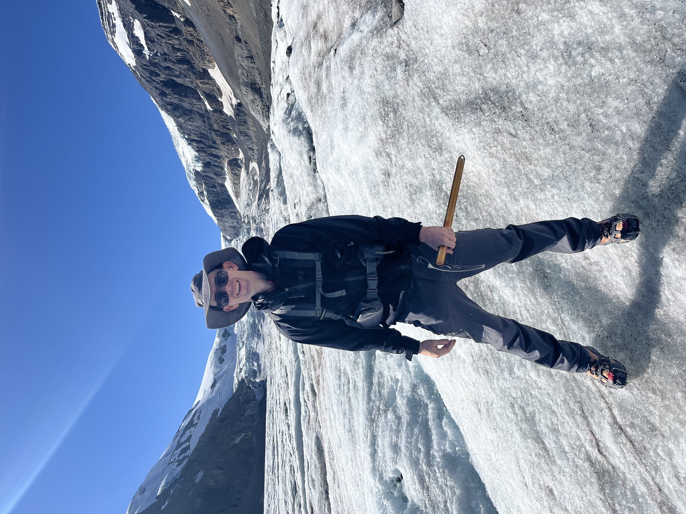
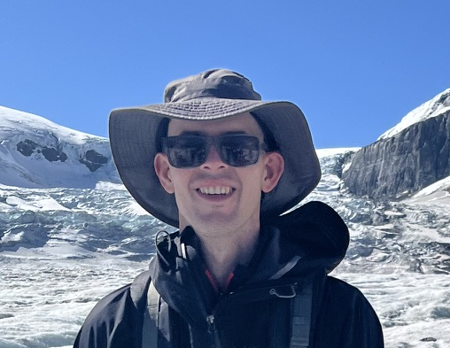

# Bio

## Picture (full)

{download}`Download <../_static/bio_pic_full.jpeg>`

## Picture (zoom)

{download}`Download <../_static/bio_pic_zoom.png>`

## Bio

I graduated from the [United States Naval Academy](https://www.usna.edu/homepage.php) in 2014 with a degree in Applied Mathematics. Between 2014 and 2020, I was an officer aboard the [USS Mobile Bay](https://en.wikipedia.org/wiki/USS_Mobile_Bay), [USS Coronado](https://en.wikipedia.org/wiki/USS_Coronado_(LCS-4)), and [USS Omaha](https://en.wikipedia.org/wiki/USS_Omaha_(LCS-12)). Since then I have been a data scientist and a software engineer at various companies. I joined the [Pallets](https://palletsprojects.com/) team as a maintainer for [Click](https://github.com/pallets/click) in 2023. In my free time, I enjoy rock climbing and carpentry.
